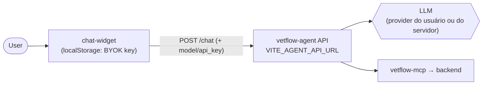
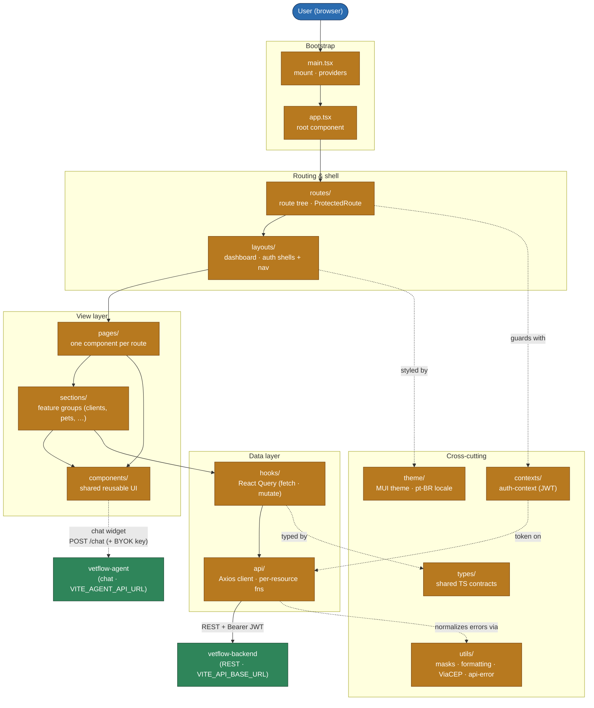

# VetFlow Frontend

Single-page application for VetFlow — a veterinary clinic management system. This
README covers frontend-wide concerns (install, environment, scripts, build and
deploy). For details on any one source layer, follow the links in
[Source structure](#source-structure) — each folder has its own README scoped to
that level.

Built with **React 19**, **TypeScript**, **Vite 6**, **Material-UI 7**,
**React Router v7**, **React Query (@tanstack/react-query)**, **React Hook Form +
Yup**, and **Axios**. Tested with **Vitest + Testing Library**.

> Part of [VetFlow](https://github.com/IannCarvalho/vetflow) — an umbrella repo
> that **maps four independent repositories** (not a monorepo): this frontend,
> the [`vetflow-backend`](https://github.com/IannCarvalho/vetflow-backend) API,
> the [`vetflow-agent`](https://github.com/IannCarvalho/vetflow-agent) chat
> service and the [`vetflow-mcp`](https://github.com/IannCarvalho/vetflow-mcp)
> tools. Each is deployed and versioned on its own.

**Live demo:** [vetflow-frontend-demo.vercel.app](https://vetflow-frontend-demo.vercel.app)
— runs in demo mode; use the **"Entrar como visitante"** button to sign in as a
read-only visitor.

## Language Convention

Code identifiers, file names, types and comments are in **English**; all
user-facing strings (labels, placeholders, validation and toast messages, menu
items) are in **Portuguese (pt-BR)**.

## Prerequisites

- Node.js **v20 or higher** (the lockfile is resolved under Node 20; see
  `package.json` `engines`)
- npm (or yarn)

## Install

```bash
npm install
```

## Environment Variables

Copy `.env.example` to `.env` and fill in the values:

```bash
cp .env.example .env
```

| Variable                 | Required | Description                                                        |
| ------------------------ | -------- | ------------------------------------------------------------------ |
| `VITE_API_BASE_URL`      | Yes      | Backend server URL (e.g. `http://localhost:8080`)                  |
| `VITE_AGENT_API_URL`     | For chat | AI assistant API URL (vetflow-agent, e.g. `http://localhost:8700`) |
| `VITE_DEMO_MODE`         | Optional | Set to `true` only for the public demo: shows an "Entrar como visitante" button on sign-in that logs in with the seeded demo account. Requires `VITE_API_BASE_URL` to point at a demo backend. Leave unset/`false` for production. |
| `VITE_GOOGLE_CLIENT_ID`  | For SSO  | Google OAuth 2.0 client ID (Google Cloud Console)                  |
| `VITE_FACEBOOK_APP_ID`   | Optional | Facebook OAuth app ID — placeholder for a future provider          |
| `VITE_DISCORD_CLIENT_ID` | Optional | Discord OAuth client ID — placeholder for a future provider        |

Only variables prefixed with `VITE_` are exposed to the client bundle.

## Scripts

Defined in `package.json`:

| Script              | Command            | Purpose                                            |
| ------------------- | ------------------ | -------------------------------------------------- |
| `npm run dev`       | `vite`             | Start the dev server at `http://localhost:3039`    |
| `npm run build`     | `tsc && vite build`| Type-check, then build to `dist/`                  |
| `npm run start`     | `vite preview`     | Preview the production build locally               |
| `npm test`          | `vitest run`       | Run the test suite once                            |
| `npm run test:a11y` | `playwright test`  | Run the accessibility (axe-core) checks            |
| `npm run lint`      | `eslint ...`       | Lint `src/**/*.{js,jsx,ts,tsx}`                    |
| `npm run lint:fix`  | `eslint --fix ...` | Lint and auto-fix                                  |
| `npm run fm:check`  | `prettier --check` | Check formatting                                   |
| `npm run fm:fix`    | `prettier --write` | Fix formatting                                     |
| `npm run fix:all`   | lint + format      | Run all lint and format fixes                      |

## Vite Configuration

Configured in `vite.config.ts`:

- **Dev/preview port** fixed at `3039` (`strictPort: true`, `host: true`).
- **`src` path alias** — import from `src/...` instead of long relative paths.
- **`vite-plugin-checker`** runs TypeScript and ESLint in-band during `dev`, with
  an error overlay (top-left).
- **`@vitejs/plugin-react-swc`** for fast React compilation.
- **Vitest** block: `globals: true`, `jsdom` environment, setup file
  `src/test/setup.ts`, test glob `src/**/*.{test,spec}.{ts,tsx}`. Test files live
  next to the code they cover.

## AI Assistant widget

A floating chat widget (`src/components/chat-widget/`) is mounted on the
dashboard layout, so it appears on every authenticated screen. It lets users ask
natural-language questions about the clinic ("how many pets does Maria have?")
and the AI answers using **real data**, fetched through the
[`vetflow-agent`](https://github.com/IannCarvalho/vetflow-agent) API (which in turn calls the `vetflow-mcp`
tools against the backend).



- **Backend dependency:** the widget talks to the agent API at
  `VITE_AGENT_API_URL` (default `http://localhost:8700`) — a service separate
  from the main backend. It uses its own Axios client (`src/api/agentApi.ts`),
  not the backend's.
- **BYOK (bring your own key):** the gear (⚙️) opens a settings dialog where the
  user picks a provider (OpenAI/Anthropic/Gemini), pastes their API key and
  clicks **Validate** — the agent lists the real models that key can use and
  populates the model dropdown. **The key is stored only in the browser's
  `localStorage`**, never sent to the VetFlow backend; it travels only in the
  `POST /chat` body to the agent. Leaving it blank uses the server's default
  provider.
- Responses render Markdown, and each tool the agent called is shown as a chip.

> **Note — no LiteLLM here.** This frontend is React/TypeScript and never
> imports `litellm`; the LLM lives entirely in the
> [`vetflow-agent`](https://github.com/IannCarvalho/vetflow-agent) service. The agent's import-ordering rule
> (import `litellm` right after reading the env, and at module top-level, because
> LiteLLM reads environment variables at **import time**) is documented in the
> agent's README and does **not** apply to this repo. Cross-referenced here only
> so the detail isn't searched for in the wrong place.

## Build & Deploy

```bash
npm run build     # outputs static assets to dist/
```

Deployment targets **Vercel** via `vercel.json`:

- `buildCommand`: `npm run build`
- `installCommand`: `npm install`
- `outputDirectory`: `dist`
- `framework`: `vite`
- SPA rewrite: every non-asset path falls through to `/index.html` so client-side
  routing works on deep links.

## Continuous Integration

`.github/workflows/ci.yml` runs on every push to `main`/`master` and on every
pull request, as three sequential jobs:

1. **Reject merge conflict markers** (`no-conflict-markers`) — fails the build if
   any tracked file still contains `<<<<<<<`, `=======` or `>>>>>>>`. The same
   check runs locally via the `pre-commit` hook (see
   [Git Hooks](#git-hooks--merge-conflict-marker-gate)).
2. **Typecheck, build & test** (`build-test`, Node 20) — `npx tsc --noEmit`,
   `npx vite build` and `npx vitest run`.
3. **Accessibility gate (axe-core)** (`a11y`, Node 20) — installs Playwright
   Chromium and runs `npm run test:a11y`, which boots a `vite preview` of the
   build and audits the rendered pages with axe-core. This job finishes last
   (it waits on the preview deploy), so a "pending" status here is not a failure.

## Source structure

Each source folder has its own README describing that layer. Start here and drill
into whichever concern you are navigating:



Data flows **down** the view layer and **out** through the data layer: `pages`
compose `sections`/`components`, which read and write via React Query `hooks`,
which call the typed `api` functions — the only layer that talks HTTP. UI never
calls Axios directly, and nothing below `pages` knows about routing. `theme`,
`types`, `utils` and the auth `contexts` are cross-cutting concerns the other
layers lean on.

| Folder                                        | What lives there                                                        |
| --------------------------------------------- | ----------------------------------------------------------------------- |
| [`src/api/`](src/api/README.md)               | Axios instance and typed, per-resource API functions                    |
| [`src/components/`](src/components/README.md) | Shared, reusable UI components (iconify, logo, scrollbar, search, …)     |
| [`src/hooks/`](src/hooks/README.md)           | React Query hooks for data fetching and mutations                       |
| [`src/layouts/`](src/layouts/README.md)       | App shell layouts (dashboard, auth) and nav configuration               |
| [`src/pages/`](src/pages/README.md)           | Route-level page components                                             |
| [`src/routes/`](src/routes/README.md)         | Route definitions and `ProtectedRoute` gating                           |
| [`src/sections/`](src/sections/README.md)     | Feature-specific component groups (clients, pets, consultations, …)     |
| [`src/theme/`](src/theme/README.md)           | MUI theme configuration, palette and pt-BR locale                       |
| [`src/types/`](src/types/README.md)           | Shared TypeScript type definitions                                      |
| [`src/utils/`](src/utils/README.md)           | Formatting, masks, ViaCEP and API-error helpers                         |

Other `src/` entry points: `main.tsx` (bootstrap), `app.tsx` (root component),
`config-global.ts`, `global.css`, and `contexts/` (`auth-context.tsx`).

## Troubleshooting

**Backend connection** — verify `VITE_API_BASE_URL` matches your running backend
and check the browser console for CORS errors.

**Data not loading** — confirm the endpoints in `src/api/` match the backend
routes, inspect React Query status, and verify authentication.

**Lockfile desync in CI** — regenerate `package-lock.json` under **Node 20** (the
version CI uses), not a newer local default; different npm majors resolve
transitive/optional platform binaries differently.

## Git Hooks — Merge Conflict Marker Gate

A tracked `pre-commit` hook refuses any commit containing unresolved merge
conflict markers (`<<<<<<<`, `=======`, `>>>>>>>`). The same check runs in CI as
the `no-conflict-markers` job in `.github/workflows/ci.yml`.

Activate it once per clone (git does not share `.git/hooks`):

```bash
# macOS / Linux / Git Bash
bash scripts/install-hooks.sh
```

```powershell
# Windows PowerShell
powershell -ExecutionPolicy Bypass -File scripts\install-hooks.ps1
```

Both set `git config core.hooksPath .githooks`. Emergency bypass (discouraged):
`git commit --no-verify` — note the gate still runs in CI on push.

## License

Built on the [Minimal UI](https://github.com/minimal-ui-kit/material-kit-react)
template (MIT). VetFlow is also MIT licensed.
